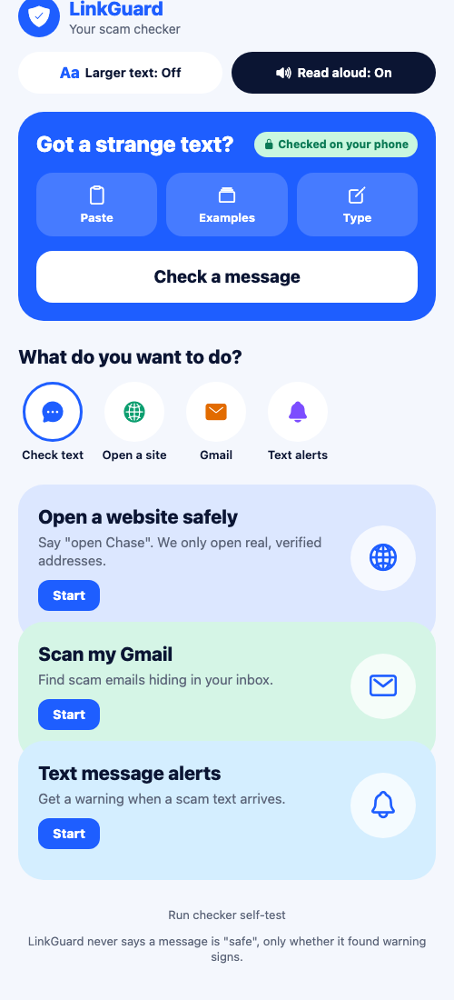
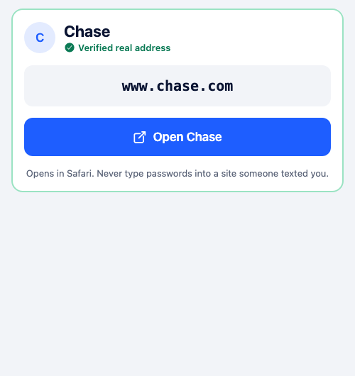
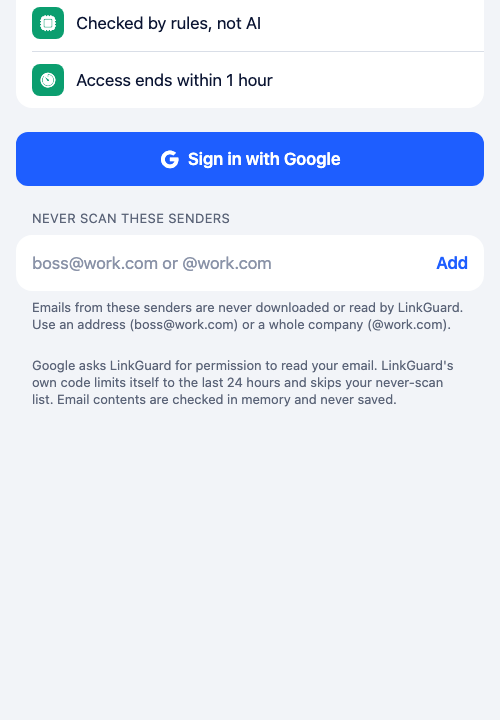
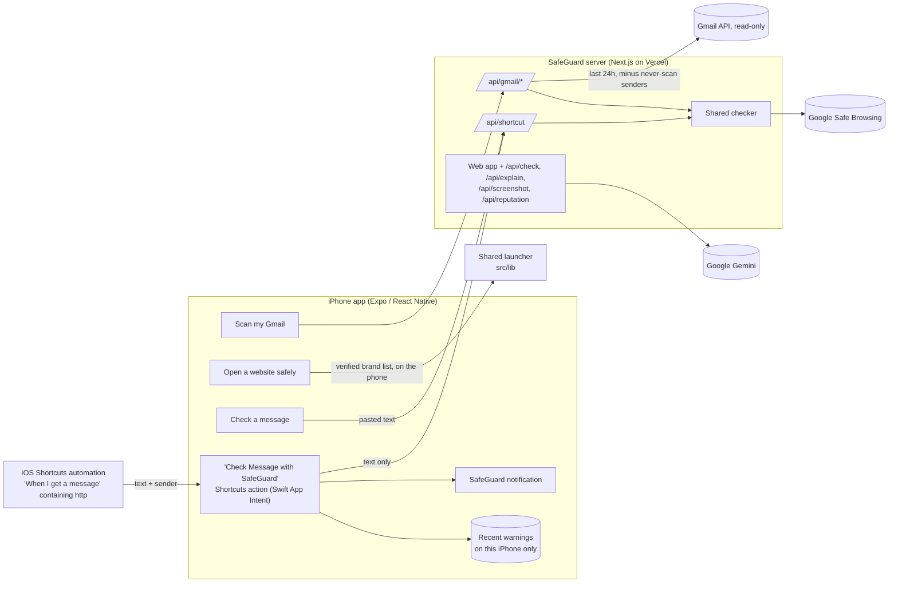

# SafeGuard

**Protection from scam emails, fake websites, and scam texts, explained in plain English. Built for older adults.**

SafeGuard is an iPhone app that scans your recent Gmail for scam emails, opens bank and shopping websites only at
their real addresses, warns you when a scam text arrives, and checks any message you paste in. It never says a
message is "safe". It only says whether it found warning signs, and why.

<p>
  
  
  
</p>

## The problem

Scam texts, fake links, and scam emails (fake bank alerts, "deposit $100 to get $3,000" offers, IRS and Social
Security threats, "Grandma, I'm in jail" messages) cost people billions of dollars every year, according to the
FTC's Consumer Sentinel reports. Most people can't tell a real link from a fake one in the moment, and most
tools show a red or green light without explaining why.

## What the app does

| Feature | How it works |
|---|---|
| **Scan my Gmail** | Sign in with Google (read-only). SafeGuard checks **only the last 24 hours** of email, skips a **never-scan list** of senders you choose, and uses its rule-based checker only (no AI). Risky emails are listed with the reasons, and you get a notification. Emails Gmail verified (DMARC) as really from a brand on the verified list aren't flagged. |
| **Open a website safely** | Say "Chase" with the keyboard microphone, or type it. SafeGuard shows the real address from a fixed list of 35 verified brands and opens exactly that. Speech is never turned into a web address; typed addresses open only on an exact hostname match, and look-alikes like `chase-secure-login.top` are refused. |
| **Text message alerts** | Apple doesn't let apps read Messages, so you add one iOS Shortcuts automation that uses SafeGuard's own **"Check Message with SafeGuard"** action. When a text with a link arrives, you get a SafeGuard notification like *"High risk text. Looks like a fake delivery notice. Don't tap the link."* Tapping it opens **Recent warnings**: the risky text, who sent it, and why. [Guide](docs/IPHONE-TEXT-ALERTS.md) |
| **Check a message** | On the Home screen: paste any text or email and see the verdict right away. There's a one-tap example scam text for trying it out. |
| **Dashboard** | Emails checked, risky emails, risky texts, and when Gmail was last scanned. |
| **Accessibility** | Native iPhone layout, a **Larger text** switch on top of iOS text size, a **Dark mode** switch (starts out matching the iPhone), big buttons, short plain sentences. |

**Web app (backup demo).** The same server also hosts a web app with a paste-a-message checker, a plain-English
explanation from Google Gemini (the AI never decides the score), screenshot reading, Google Safe Browsing, and the
voice launcher. It's at the deployed URL and in `src/components/`.

## How it decides

1. **Rules decide.** A deterministic checker (TypeScript, in `src/lib`, shared by the server and the phone) scores a
   message using 35 verified brands, link analysis (look-alike and misspelled domains, brand names used as
   disguises like `usps.com-redelivery.info`, shortened links, risky endings, letters from other alphabets), and
   scam-wording rules (gift cards, wire/crypto, secrecy, urgency, government threats, family emergencies).
   Weights are hand-set and the code is open.
2. **Reputation adds evidence.** Google Safe Browsing listings add strong evidence. "Not listed" is never treated as
   proof that something is fine.
3. **Emails get extra care against false alarms:** each link rule counts once, brand claims are checked only in the
   sender's name, marketing words alone ("today only") can't make an email risky, and brands' real mail domains
   (like `facebookmail.com`) are recognized.
4. **AI only explains (web app).** Gemini gets the checker's evidence plus the message, fenced as untrusted data, and
   writes a plain-English explanation. It can't change the score, and any "it's safe" wording is rewritten.

## Architecture



**Stack:** Expo SDK 58 + Expo Router + React Native 0.88 (iPhone app), `expo-app-intents` with a Swift App Intent
and inline Swift module (Shortcuts action, Recent warnings), Next.js 16 + React 19 + Tailwind 4 (server and web),
`tldts` (public-suffix-aware domain parsing), `@google/genai`, Vitest. Hosted on Vercel.

```
mobile/src/app/       iPhone screens: Home (dashboard + Check a message), Scan my Gmail, Open a website, Text alerts
mobile/src/           theme (light/dark design tokens), shared components, Gmail, warnings, keyboard handling
mobile/app-intents/   Swift: the "Check Message with SafeGuard" Shortcuts action and the Recent warnings store
src/lib/              shared logic: checker, brands, launcher, Gmail rules, never-scan list, reputation
src/app/api/          server routes: gmail/{start,callback,scan,signout}, shortcut, check, explain, screenshot, reputation
src/components/       web app UI (backup demo)
docs/                 privacy, Gmail setup, text alerts, demo script
```

## Setup

**Prerequisites:** Node.js 20+ (built with 24). For the iPhone app: a Mac with Xcode, an iPhone in Developer Mode,
and a free Apple ID. (Expo Go can run most screens, but not the Shortcuts action, which needs the installed app.)

```bash
git clone https://github.com/Deepakrajkumar007/safeguard.git
cd safeguard
npm install
cp .env.example .env.local   # then fill in the keys (see below)
npm run dev                  # server + web app at http://localhost:3000
npm test                     # 208 tests
npm run check -- "USPS: package on hold, pay at https://usps.com-redelivery.info"
```

**iPhone app:**
```bash
cd mobile
npm install
# mobile/.env.local (git-ignored):
#   EXPO_PUBLIC_API_URL=https://<your-deployment>.vercel.app
#   EXPO_PUBLIC_LINKGUARD_KEY=<same value as LINKGUARD_APP_KEY on the server>
npx expo prebuild -p ios
npx expo run:ios --device --configuration Release
# If signing fails, build with Xcode's command line instead:
#   cd ios && xcodebuild -workspace SafeGuard.xcworkspace -scheme SafeGuard -configuration Release \
#     -destination id=<iPhone UDID> -allowProvisioningUpdates -allowProvisioningDeviceRegistration build
```
Set your own `ios.bundleIdentifier` and `ios.appleTeamId` in `mobile/app.json`. Free Apple ID installs last 7 days.

**Server environment variables** (`.env.local` and your host's secret settings):

| Variable | Needed for |
|---|---|
| `LINKGUARD_APP_KEY` | App and Shortcuts action requests (`x-linkguard-key` header) |
| `GOOGLE_CLIENT_ID`, `GOOGLE_CLIENT_SECRET`, `SESSION_SECRET` | Scan my Gmail ([setup](docs/GMAIL-SETUP.md)) |
| `GOOGLE_SAFE_BROWSING_KEY` | Safe Browsing reputation check |
| `GEMINI_API_KEY` (+ optional `GEMINI_MODEL`) | Web app explanation and screenshot reading |

Every feature degrades gracefully: without keys, the rule-based checker still works.

**Deploy:** `npx vercel deploy --prod`, then add the variables in Vercel as sensitive environment variables.

## Testing

**208 automated tests** (`npm test`), including:
- 37 real brand login links (Chase, Amazon, Microsoft, PayPal, Google, Apple, banks, USPS, IRS, SSA, Medicare) that
  must score **zero**, because a false alarm in front of a real person is worse than a miss
- real sites that resemble brands (`citizensbank.com`, `applebees.com`, `medicaid.gov`) that must not be flagged
- scam stories (bank, delivery, toll, IRS, grandparent, tech support, "pay $100 get $3,000") that must score high
- link tricks (`paypa1.com`, `arnazon.com`, Cyrillic `аpple.com`, `chase.com@evil.top`, IP addresses)
- the voice launcher: names, dictation punctuation, look-alike addresses refused, every launch URL on its own domain
- Gmail: query-injection-proof never-scan list, spelling checks (`gmail.con`), sender matching that ignores display
  names, verified senders, real Facebook mail vs. fake Facebook senders, calm marketing emails
- OAuth tokens, rate limits, prompt-injection fencing, and the "never says safe" filter

The iPhone flow was tested on a real iPhone 15 Pro: the Shortcuts action checks the text, posts SafeGuard's
notification, and adds it to Recent warnings.

## Privacy and safety

Short version: Gmail scanning is limited to 24 hours, skips senders you choose, uses no AI, and returns only
summaries to the phone. The Shortcuts action sends only the message text to the server; the server stores nothing.
Texts SafeGuard warns you about are kept **only on your iPhone** (last 20, one tap to clear). Only links go to Google
Safe Browsing. Full details, including what each third party receives: **[docs/PRIVACY.md](docs/PRIVACY.md)**.

## Limitations (honest)

- **Not benchmarked.** The checker's weights are hand-tuned and haven't been measured on a large labeled dataset.
  Treat results as warning signs, not a probability.
- **Text alerts** depend on a Shortcuts automation the user builds once, and Apple decides when it runs. iOS requires
  a "Message Contains" word, so with `http` texts without links aren't checked. Texts you send yourself may not
  trigger it.
- **Recent warnings** are stored in the app's private storage on the iPhone (not the keychain), so they're as safe as
  the phone's own lock. They're limited to the last 20 and can be cleared.
- **Gmail** uses Google's testing mode (up to 100 test users). The `gmail.readonly` permission can read all mail;
  the 24-hour window and never-scan list are enforced by SafeGuard's code. Public launch needs Google verification.
- **Brand coverage:** 35 verified brands. Others get only the general checks.
- **Builds:** a free Apple ID can install the app on your own iPhone for 7 days. TestFlight and the App Store need
  the Apple Developer Program.
- **Safe Browsing** Lookup API is for non-commercial use; a commercial product would use Google Web Risk.
  **Gemini free tier** content may be used by Google to improve its products.
- **Server protection** (app key + per-instance rate limits) slows abuse but isn't strong authentication.

## Roadmap

- TestFlight build; an SMS **Message Filter extension** that sorts unknown-sender scam texts into Junk
- Benchmark on public phishing and legitimate URL sets, and publish detection and false-alarm rates
- Encrypt Recent warnings with the keychain; optional automatic clearing after a few days
- Domain age (RDAP) and more reputation sources; Google Web Risk for commercial use
- Family alerts ("Mom got a high-risk text"), more brands, Spanish and other languages

## License

[MIT](LICENSE). Not affiliated with any bank, company, or government agency named in the brand list.
