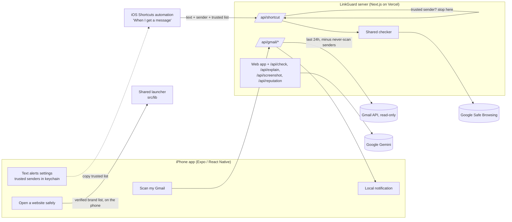

# LinkGuard

**Protection from scam emails, fake websites, and scam texts, explained in plain English. Built for older adults.**

LinkGuard is an iPhone app with three jobs: scan your recent Gmail for scam emails, open bank and shopping
websites only at their real addresses, and warn you when a scam text arrives, while ignoring texts from people
you trust. It never says a message is "safe". It only says whether it found warning signs, and why.

<p>
  
  
  
</p>

## The problem

Scam texts, fake links, and scam emails (fake bank alerts, "deposit $100 to get $3,000" offers, IRS and Social
Security threats, "Grandma, I'm in jail" messages) cost people billions of dollars every year, according to the
FTC's Consumer Sentinel reports. Most people can't tell a real link from a fake one in the moment, and most
tools show a red or green light without explaining why.

## What the app does

| Feature | How it works |
|---|---|
| **Scan my Gmail** | Sign in with Google (read-only). LinkGuard checks **only the last 24 hours** of email, skips a **never-scan list** of senders you choose, and uses its rule-based checker only (no AI). Risky emails are listed with the reasons, and you get a notification. Emails Gmail verified (DMARC) as really from a bank or brand on the verified list aren't flagged. |
| **Open a website safely** | Say "Chase" with the keyboard microphone, or type it. LinkGuard shows the real address from a fixed list of 35 verified brands and opens exactly that. Speech is never turned into a web address; typed addresses open only on an exact hostname match, and look-alikes like `chase-secure-login.top` are refused. |
| **Text message alerts** | Apple doesn't let apps read Messages, so you set up an iOS Shortcuts automation once. New texts with a link go to LinkGuard's rule-based checker, and you get a warning like *"LinkGuard: High risk text. Looks like a fake delivery notice. Don't tap the link."* A **Trusted senders** list (phone numbers, iCloud emails, or contact names) makes LinkGuard ignore texts from family and friends. [Guide](docs/IPHONE-TEXT-ALERTS.md) |
| **Accessibility** | Native iPhone layout, a **Larger text** switch on top of iOS text size, **read aloud** of results (on by default), big buttons, short plain sentences. |

**Web app (backup demo).** The same server also hosts a web app with a paste-a-message checker, a plain-English
explanation from Google Gemini (the AI never decides the score), screenshot reading, Google Safe Browsing, and the
voice launcher. It's at the deployed URL and in `src/components/`.

## How it decides

1. **Rules decide.** A deterministic checker (TypeScript, in `src/lib`, shared by the server and the phone) scores a
   message using 35 verified brands, link analysis (look-alike and misspelled domains, brand names used as
   disguises like `usps.com-redelivery.info`, shortened links, risky endings, letters from other alphabets), and
   scam-wording rules (gift cards, wire/crypto, secrecy, urgency, government threats, family emergencies).
   Weights are hand-set and the code is open.
2. **Reputation adds evidence.** Google Safe Browsing listings add strong evidence. "Not listed" is never treated as
   proof that something is fine.
3. **Emails get extra care against false alarms:** each link rule counts once, brand claims are checked only in the
   sender's name, and marketing words alone ("today only") can't make an email risky.
4. **AI only explains (web app).** Gemini gets the checker's evidence plus the message, fenced as untrusted data, and
   writes a plain-English explanation. It can't change the score, and any "it's safe" wording is rewritten.

## Architecture



**Stack:** Expo SDK 58 + Expo Router + React Native 0.88 (iPhone app), Next.js 16 + React 19 + Tailwind 4 (server
and web), `tldts` (public-suffix-aware domain parsing), `@google/genai`, Vitest. Hosted on Vercel.

```
mobile/src/app/   iPhone screens: Home, Scan my Gmail, Open a website, Text alerts
mobile/src/       theme (design tokens), shared list/button components, Gmail and trusted-sender storage
src/lib/          shared logic: checker, brands, launcher, Gmail rules, trusted senders, reputation
src/app/api/      server routes: gmail/{start,callback,scan,signout}, shortcut, check, explain, screenshot, reputation
src/components/   web app UI (backup demo)
docs/             privacy, Gmail setup, text alerts, demo script
```

## Setup

**Prerequisites:** Node.js 20+ (built with 24). An iPhone with **Expo Go**, or Xcode for a standalone build.

```bash
git clone https://github.com/Deepakrajkumar007/linkguard.git
cd linkguard
npm install
cp .env.example .env.local   # then fill in the keys (see below)
npm run dev                  # server + web app at http://localhost:3000
npm test                     # 220 tests
npm run check -- "USPS: package on hold, pay at https://usps.com-redelivery.info"
```

**iPhone app:**
```bash
cd mobile
npm install
# mobile/.env.local (git-ignored):
#   EXPO_PUBLIC_API_URL=https://<your-deployment>.vercel.app
#   EXPO_PUBLIC_LINKGUARD_KEY=<same value as LINKGUARD_APP_KEY on the server>
npx expo start               # scan the QR code with the iPhone camera (sign in to Expo Go and Expo CLI)
# or, with Xcode and a free Apple ID, install a standalone build on a plugged-in iPhone:
npx expo run:ios --device --configuration Release
```

**Server environment variables** (`.env.local` and your host's secret settings):

| Variable | Needed for |
|---|---|
| `LINKGUARD_APP_KEY` | App and Shortcut requests (`x-linkguard-key` header) |
| `GOOGLE_CLIENT_ID`, `GOOGLE_CLIENT_SECRET`, `SESSION_SECRET` | Scan my Gmail ([setup](docs/GMAIL-SETUP.md)) |
| `GOOGLE_SAFE_BROWSING_KEY` | Safe Browsing reputation check |
| `GEMINI_API_KEY` (+ optional `GEMINI_MODEL`) | Web app explanation and screenshot reading |

Every feature degrades gracefully: without keys, the rule-based checker still works.

**Deploy:** `npx vercel deploy --prod`, then add the variables in Vercel as sensitive environment variables.

## Testing

**220 automated tests** (`npm test`), including:
- 37 real brand login links (Chase, Amazon, Microsoft, PayPal, Google, Apple, banks, USPS, IRS, SSA, Medicare) that
  must score **zero**, because a false alarm in front of a real person is worse than a miss
- real sites that resemble brands (`citizensbank.com`, `applebees.com`, `medicaid.gov`) that must not be flagged
- scam stories (bank, delivery, toll, IRS, grandparent, tech support, "pay $100 get $3,000") that must score high
- link tricks (`paypa1.com`, `arnazon.com`, Cyrillic `аpple.com`, `chase.com@evil.top`, IP addresses)
- the voice launcher: names, dictation punctuation, look-alike addresses refused, every launch URL on its own domain
- Gmail: query-injection-proof never-scan list, verified senders, display-name spoofs, calm marketing emails
- trusted senders: phone formats, iCloud emails, contact names, and the server skipping them before any check
- OAuth tokens, rate limits, prompt-injection fencing, and the "never says safe" filter

## Privacy and safety

Short version: Gmail scanning is limited to 24 hours and skips senders you choose, uses no AI, and returns only
summaries to the phone; texts from trusted senders are ignored; nothing is stored; only links go to Google Safe
Browsing. Full details, including what each third party receives: **[docs/PRIVACY.md](docs/PRIVACY.md)**.

## Limitations (honest)

- **Not benchmarked.** The checker's weights are hand-tuned and haven't been measured on a large labeled dataset.
  Treat results as warning signs, not a probability.
- **Trusted senders (current version):** the Shortcut sends the text, sender, and trusted list to the server, which
  drops trusted senders' texts before checking them. They still travel to the server. The planned native Shortcuts
  action (below) stops them on the phone.
- **Text alerts** depend on an iOS Shortcuts automation the user builds; Apple decides when it runs. With the `http`
  filter, texts without links aren't checked, and the trusted list needs Shortcuts to report the sender.
- **Gmail** uses Google's testing mode (up to 100 test users). The `gmail.readonly` permission can read all mail;
  the 24-hour window and never-scan list are enforced by LinkGuard's code. Public launch needs Google verification.
- **Brand coverage:** 35 verified brands. Others get only the general checks.
- **Builds:** Expo Go for development; a free Apple ID can install a standalone build on your own iPhone for 7 days.
  TestFlight and the App Store need the Apple Developer Program.
- **Safe Browsing** Lookup API is for non-commercial use; a commercial product would use Google Web Risk.
  **Gemini free tier** content may be used by Google to improve its products.
- **Server protection** (app key + per-instance rate limits) slows abuse but isn't strong authentication.

## Roadmap

- A native **"Check Message with LinkGuard"** Shortcuts action (`expo-app-intents`) that drops trusted senders on the
  phone and turns the 7-step Shortcut into one step
- TestFlight build; an SMS **Message Filter extension** that sorts unknown-sender scam texts into Junk
- Benchmark on public phishing and legitimate URL sets, and publish detection and false-alarm rates
- Domain age (RDAP) and more reputation sources; Google Web Risk for commercial use
- Family alerts ("Mom got a high-risk text"), more brands, Spanish and other languages

## License

[MIT](LICENSE). Not affiliated with any bank, company, or government agency named in the brand list.
