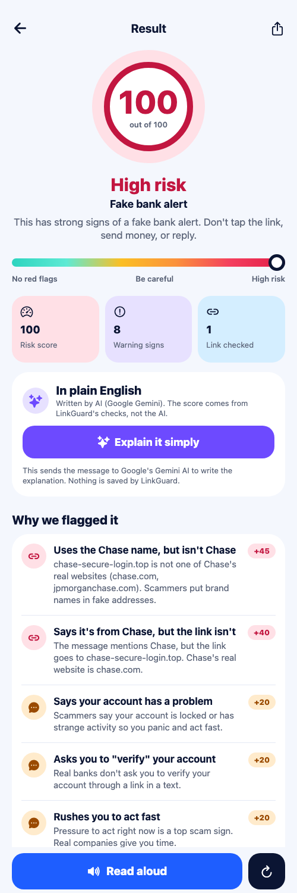
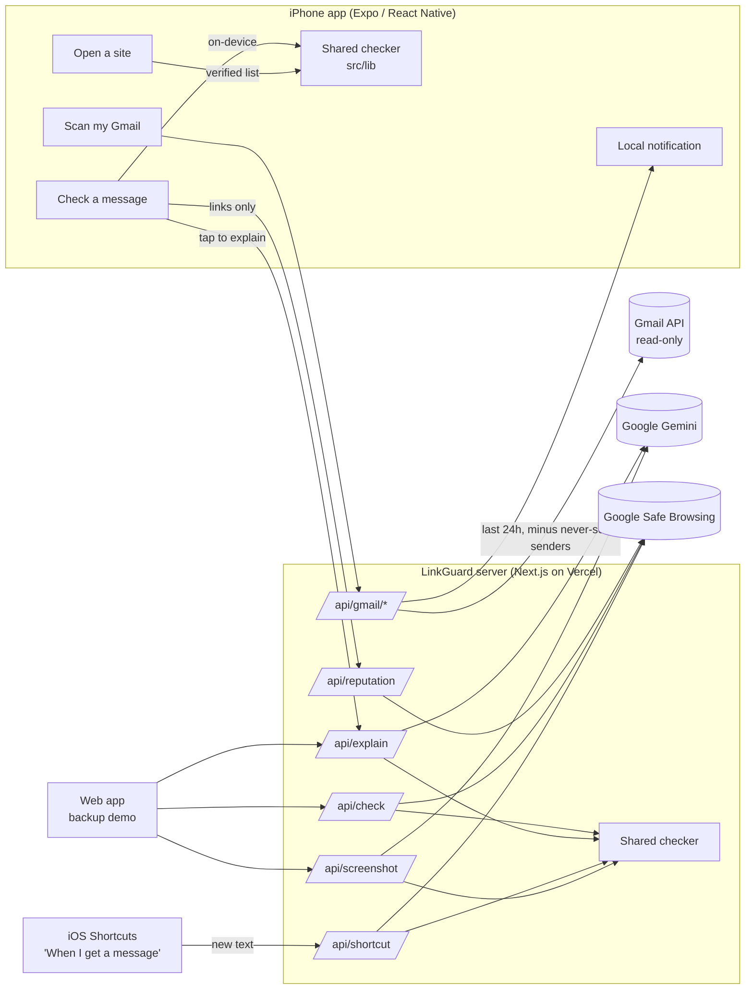

# LinkGuard

**A scam checker for texts, links, and emails that explains *why* in plain English. Built for older adults.**

LinkGuard is an iPhone app (plus a web app) that checks a suspicious message, shows a risk score, points to
the exact warning signs ("the real website is `com-redelivery.info`, not usps.com"), and says what to do next.
It never says a message is "safe". It only says whether it found warning signs.

<p>
  
  
  
</p>

## The problem

Scam texts, fake links, and scam emails (fake bank alerts, "deposit $100 to get $3,000" offers, IRS and Social
Security threats, "Grandma, I'm in jail" messages) cost people billions of dollars every year, according to the
FTC's Consumer Sentinel reports. Most people can't tell a real link from a fake one in the moment, and most
tools show a red or green light without explaining why.

## What it does

| Feature | Where | How |
|---|---|---|
| **Check a message** | App, web | Paste a text or link. The checker runs **on the phone**: look-alike and misspelled brand domains, brand names used as disguises (`usps.com-redelivery.info`), shortened links, risky domain endings, letters from other alphabets, and scam wording (gift cards, wire/crypto, secrecy, urgency, government threats, family emergencies). |
| **Where the link really goes** | App, web | Underlines the part of the address that actually decides who owns the site. |
| **What to do now** | App, web | Concrete steps: don't tap, call the number on your card, forward to 7726, report at reportfraud.ftc.gov, identitytheft.gov. |
| **Explain it simply** | App, web | Google Gemini explains the verdict in plain English. **The AI never decides the score.** In the app it runs only when you tap. |
| **Google Safe Browsing** | App, web | Links (never the message) are checked against Google's list of dangerous sites. A listing adds strong evidence. |
| **Open a site safely** | App, web | Say or type "Chase". LinkGuard shows the real address from a fixed verified list and opens exactly that. Speech is never turned into a URL; typed addresses open only on an exact hostname match. |
| **Scan my Gmail** | App | Google sign-in (read-only). Scans **only the last 24 hours**, skips a **never-scan list** of senders, uses rules only (no AI), and sends a notification if risky emails are found. |
| **Text alerts** | iPhone Shortcuts | Apple doesn't let apps read Messages. A Shortcuts automation you set up sends new texts with links to LinkGuard and shows a warning. [Guide](docs/IPHONE-TEXT-ALERTS.md) |
| **Screenshot reading** | Web | Upload a screenshot; Gemini transcribes it and the checker scores the transcript. |
| **Accessibility** | App, web | Read-aloud of every result (on by default), a Larger text switch, big buttons, short plain sentences. |

## How it decides

1. **Rules decide.** A deterministic checker (TypeScript, shared by the server and the phone) scores the message
   from 35 verified brands, link analysis, and scam-wording rules. Weights are hand-set and the code is open.
2. **Reputation adds evidence.** Google Safe Browsing listings add 60 points. "Not listed" is never treated as
   proof that something is fine.
3. **AI explains.** Gemini gets the checker's evidence plus the message (fenced as untrusted data, so a scam text
   can't instruct it) and writes a plain-English explanation and a second opinion. It can't change the score.
   Any "it's safe" phrasing is rewritten on the server.

## Architecture



**Stack:** Next.js 16 + React 19 + Tailwind 4 (server and web), Expo SDK 58 + Expo Router + React Native 0.88
(iPhone app), `tldts` (public-suffix-aware domain parsing), `@google/genai` (Gemini), Vitest. Hosted on Vercel.

```
src/lib/          shared checker: brands, link analysis, wording rules, scoring, launcher, Gmail, reputation
src/app/api/      server routes: check, explain, reputation, screenshot, shortcut, gmail/{start,callback,scan,signout}
src/components/   web app UI
mobile/src/       iPhone app (screens in mobile/src/app)
docs/             privacy, Gmail setup, text alerts, demo script
demo/             fake scam-text screenshot for the screenshot demo
```

## Setup

**Prerequisites:** Node.js 20+ (built with 24), an iPhone with **Expo Go** for the app.

```bash
git clone https://github.com/Deepakrajkumar007/linkguard.git
cd linkguard
npm install
cp .env.example .env.local   # then fill in the keys (see below)
npm run dev                  # web app + API at http://localhost:3000
npm test                     # 198 tests
npm run check -- "USPS: package on hold, pay at https://usps.com-redelivery.info"
```

**iPhone app:**
```bash
cd mobile
npm install
# optional mobile/.env.local:
#   EXPO_PUBLIC_API_URL=https://<your-deployment>.vercel.app
#   EXPO_PUBLIC_LINKGUARD_KEY=<same value as LINKGUARD_APP_KEY on the server>
npx expo start               # scan the QR code with the iPhone camera (sign in to Expo Go and Expo CLI)
```
Without `EXPO_PUBLIC_API_URL`, the app uses the laptop's server on the same wifi (port 3000).

**Environment variables** (server, `.env.local` and your host's secret settings):

| Variable | Needed for |
|---|---|
| `GEMINI_API_KEY` (+ optional `GEMINI_MODEL`, default `gemini-3.6-flash`) | AI explanation, screenshot reading |
| `LINKGUARD_APP_KEY` | App and Shortcut requests (`x-linkguard-key` header) |
| `GOOGLE_SAFE_BROWSING_KEY` | Safe Browsing reputation check |
| `GOOGLE_CLIENT_ID`, `GOOGLE_CLIENT_SECRET`, `SESSION_SECRET` | Gmail scanning ([setup](docs/GMAIL-SETUP.md)) |

Every feature degrades gracefully: without keys, the rule-based checker still works.

**Deploy:** `npx vercel deploy --prod`, then add the variables in Vercel as sensitive environment variables.

## Testing

- **198 automated tests** (`npm test`), including:
  - 37 real brand login links (Chase, Amazon, Microsoft, PayPal, Google, Apple, banks, USPS, IRS, SSA, Medicare)
    that must score **zero** (false alarms are worse than misses in front of a real person)
  - real sites that resemble brands (`citizensbank.com`, `applebees.com`, `medicaid.gov`) that must not be called look-alikes
  - scam stories (bank, delivery, toll, IRS, grandparent, tech support, "pay $100 get $3,000") that must score high
  - link tricks (`paypa1.com`, `arnazon.com`, Cyrillic `аpple.com`, `chase.com@evil.top`, IP addresses)
  - prompt-injection fencing, the "never says safe" filter, Gmail query injection, OAuth tokens, rate limits
  - legitimate marketing emails (promos, rewards, receipts) that must stay calm
- An **on-phone self-test** (Home, then "Run checker self-test") runs 21 cases on the iPhone's own JavaScript engine.

## Privacy and safety

Short version: messages are checked on the phone; nothing is stored; Gmail scanning is limited to 24 hours and
skips senders you choose; only links go to Google Safe Browsing; the AI is optional and clearly labeled.
Full details, including what each third party receives: **[docs/PRIVACY.md](docs/PRIVACY.md)**.

## Limitations (honest)

- **Not benchmarked.** The checker's weights are hand-tuned and have not been measured on a large labeled dataset.
  Treat the score as warning signs, not a probability.
- **Brand coverage:** 35 verified brands. Others get only the general checks.
- **Expo Go:** the app currently runs through Expo Go. A standalone App Store/TestFlight build needs Xcode or an
  Apple Developer account.
- **Text alerts** depend on an iOS Shortcuts automation the user builds; Apple decides when it runs, and with the
  `http` filter, texts without links aren't checked automatically.
- **Gmail** uses Google's testing mode (up to 100 test users). The `gmail.readonly` permission can read all mail;
  the 24-hour window and never-scan list are enforced by LinkGuard's code. Public launch needs Google verification.
- **Gemini free tier:** Google may use free-tier content to improve its products. Use a paid key for real users.
- **Safe Browsing** Lookup API is for non-commercial use; a commercial product would use Google Web Risk.
- **Server protection** (app key + per-instance rate limits) slows abuse but isn't strong authentication.

## Roadmap

- Native build with Xcode / EAS, TestFlight, and an SMS **Message Filter extension** (sorts unknown-sender scam texts into Junk)
- Benchmark on public phishing and legitimate URL sets; publish detection and false-alarm rates
- Domain age (RDAP) and more reputation sources; Google Web Risk for commercial use
- Live call guard (listening on speaker, with all-party-consent guidance) and scripted demo calls
- Family alerts ("Mom got a high-risk text"), more brands, Spanish and other languages

## License

[MIT](LICENSE). Not affiliated with any bank, company, or government agency named in the brand list.
